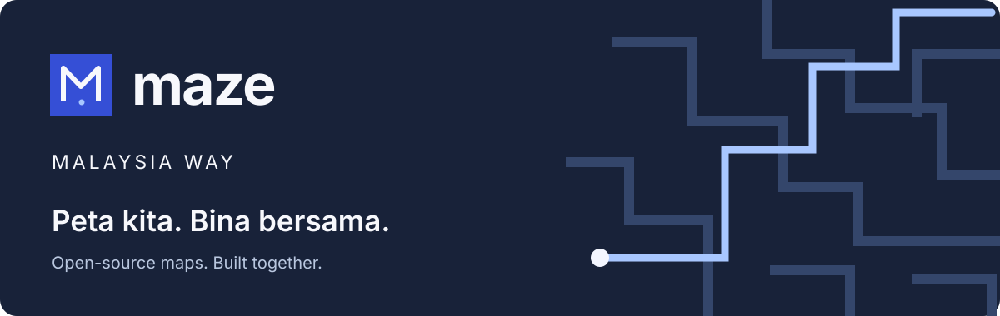
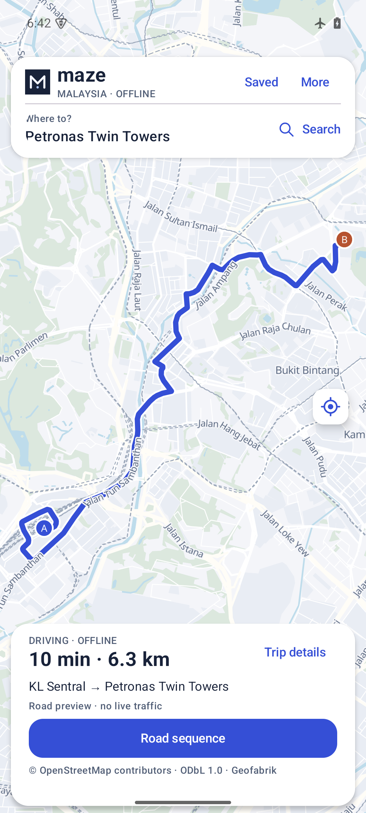
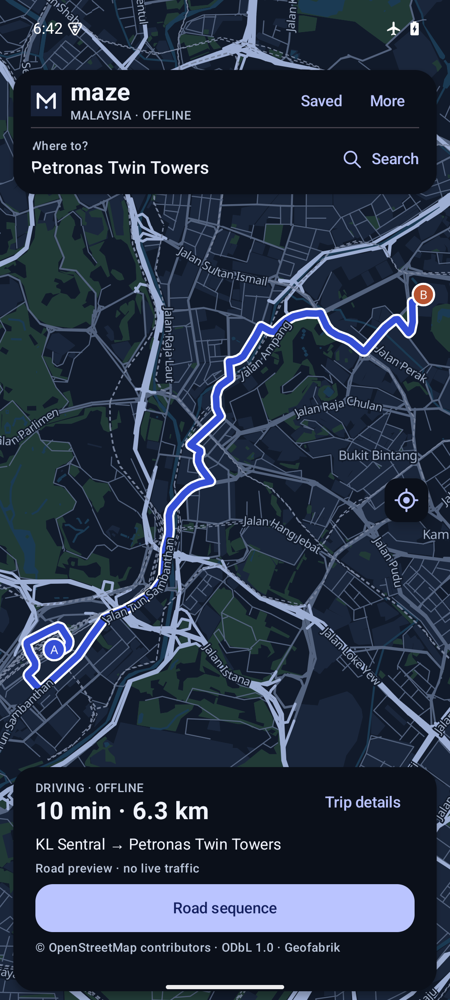

<p align="center"></p>

# Let's crack the maze code.

**Selamat datang, Malaysia.** Maze is an open-source map project for the places we know, the roads we travel, and the details that still go missing.

A shop in your taman. An entrance that is actually usable. A road in Sabah or Sarawak that deserves the same attention as one in KL. We want a map that works when the connection doesn't—and a project Malaysians can help shape.

**Peta kita. Bina bersama.** Whether you write Kotlin, contribute to OpenStreetMap, test a route, improve Bahasa Melayu copy, or explain what is wrong with a place near you: you're welcome here. Contributors from everywhere are welcome too. No contribution is too local to matter.

[Start contributing](CONTRIBUTING.md) · [Try the preview](https://github.com/ilanvkn/maze-malaysia-way/releases) · [Community discussions](https://github.com/ilanvkn/maze-malaysia-way/discussions) · [Roadmap](ROADMAP.md)

## What you can use today

Maze is a native Android app built with Kotlin, Compose and MapLibre Native. After a matching regional pack is imported, these functions run on-device:

- Vector maps with Day/Night styles and bundled fonts.
- Local name/address search, including mapped shops and places.
- Available entrances and motorway exits near a selected point, with explicit missing-data states.
- Bounded, turn-aware driving-route previews; Quick search or Careful A*.
- Explicitly saved trips and one user-requested foreground location fix. No account or advertising SDK.

The current regional pack includes Peninsular Malaysia, Sabah and Sarawak, plus Singapore and Brunei. It contains 470,369 indexed records; this is an extract count, **not complete coverage of Malaysia**. Maps are based on OpenStreetMap and can be incomplete or outdated.

**This is an early developer preview.** Routes can fail or take substantial detours. No active turn-by-turn navigation, live traffic, lane guidance, ferry routing or guaranteed fastest/legal-access claim. A mapped shop point is not a verified entrance. [Read the tested limits](docs/QUALITY.md) before relying on the preview.

<p align="center"> </p>

Actual 0.4.0 publishable minified lab APK screenshots in airplane mode, not mockups. The revised cartography separates urban land from mapped parks and uses five road tiers. [Read the design contract](DESIGN.md) and [same-source routing comparison](docs/benchmarks/2026-11-routing/README.md). Screenshots do not certify field navigation or complete accessibility.

## Try it

**Gate Pilot usability test:** [download the separate reviewer APK](https://github.com/ilanvkn/maze-malaysia-way/releases/download/v0.4.1-gate-pilot.1/Maze-Gate-Pilot-0.4.1-qa.apk) · [checksums and instructions](https://github.com/ilanvkn/maze-malaysia-way/releases/tag/v0.4.1-gate-pilot.1). Open **Try gate pilot → Try test scenarios**; no map download is needed. All scenarios are fictional and cannot be routed to. [Findings](docs/GATE-PILOT-RESULTS.md) · [comparative journey review and next tests](docs/MAP-JOURNEY-REVIEW.md).

For the improved road-approach preview, [download the APK](https://github.com/ilanvkn/maze-malaysia-way/releases/download/v0.4.4-gps.1/Maze-0.4.4-gps-review-qa.apk) and the [matching r3 map pack](https://github.com/ilanvkn/maze-malaysia-way/releases/download/v0.4.2-approaches.1/Maze-Malaysia-offline-2026-11-04-r3.zip). [Checksums and instructions](https://github.com/ilanvkn/maze-malaysia-way/releases/tag/v0.4.4-gps.1). This is an isolated, locally debug-signed Android reviewer preview. Preview each starting and arrival road on the map, check its direction and snap marker, then confirm. No entry permission is implied. GPS starts have no preselected road and require a direction check; noisy samples widen the displayed estimate. [Read the actual tests and limitations](docs/benchmarks/2026-11-gps/README.md).

For the older 0.4.0 full map preview, download the **developer-preview APK**, the matching **Malaysia offline pack ZIP**, and their checksums from the [0.4.0 community release](https://github.com/ilanvkn/maze-malaysia-way/releases/tag/v0.4.0-community.1). The APK is locally debug-signed for development, non-debuggable, and not a Play Store release. Android 8/API 26 or newer is required. Independent physical-device testing is still needed.

1. Install the APK on your own non-production test device. Maze opens a guided setup screen; no account or GPS permission is needed.
2. Keep the country ZIP intact. Allow at least 3 GB of free space for the ZIP, installed data and staging; more may be needed while updating.
3. Open Maze → **Choose downloaded ZIP** → select the ZIP in Android's file picker.
4. Try a search and route, review the two road approaches, then repeat in airplane mode. Offline operation starts **after** import.

The app links directly to the matching ZIP, supports cancelling import, and explains file/storage failures. With a map ready, open **More → Community & sharing** to invite someone through the Android Sharesheet, find a first contribution, or review a mapped-place report on GitHub. The invitation contains no location or trip data. Posting on GitHub uses your own optional account; maps stay account-free.

See [the product direction](docs/PRODUCT-DIRECTION.md) for the engineering, design, community and operations decisions. The 0.4.4 GPS/road-review preview requires r3; 0.4.0 requires r2. The source OSM date remains 4 November; the road-graph transformation changed. Existing saved trips remain local and can contain older route geometry—refresh them with the new pack.

The APK pins the three dataset hashes. Another pack version will be rejected rather than silently mixed. GPS can work without internet, but acquiring a fix indoors or after a cold start can be slow; approximate permission needs an available network location provider. [GPS behavior](docs/GPS.md).

## Build from source

Use Java 17, Android SDK platform 36/build-tools 35.0.0, Python 3.10+ for helpers, and the checked-in Gradle wrapper (8.14.3, distribution checksum pinned). Set `ANDROID_HOME` or create an untracked `local.properties` for your SDK.

```sh
python3 tools/fetch-offline-glyphs.py
./gradlew --no-daemon :app:assembleLab :app:testLabUnitTest :app:lintLab
python3 -B -m unittest discover -s tests -v
```

The first command fetches and verifies all 256 reviewed glyph blocks. Builds download dependencies; offline **app use** is a different claim. Country databases are release assets, not Git blobs. To build and pin your own data release, follow [DATA.md](DATA.md). Build helpers, graph schema and packaging are open; no proprietary map dataset is included.

CI checks build/JVM/lint/Python behavior and synthetic OSM restriction fixtures. It does not by itself prove Android interaction, field GPS, battery life or national route correctness. The repository never auto-selects a connected device.

## Work on Maze with an assistant

Use the repository's [Maze contributor skill](skills/maze-contributor/SKILL.md), [agent guidance](AGENTS.md), and [local MCP server](docs/MCP.md). The MCP server exposes three small read-only tools: pack status, bounded local search, and nearby mapped access. It runs locally with Python's standard library and does not control your phone, collect GPS, generate routes or supply traffic.

AI contributions are welcome when someone understands the code and tests it. Generated claims, invented roads, synthetic reviews and unmeasured speed promises are not. The routing core is inspectable A*, not a language model guessing directions. [Our AI and traffic work plan](docs/ROUTING-AND-AI.md) names the data and evaluation needed before those features can ship.

## Built in the open

Original Maze code is **MIT licensed**. OpenStreetMap and derived databases remain **ODbL 1.0**; Noto fonts are **OFL 1.1**; dependencies retain their own licenses. [License](LICENSE) · [Data recipe](DATA.md) · [Pack provenance](docs/DATA-RELEASE.md) · [Third-party notices](THIRD_PARTY_NOTICES.md) · [Security](SECURITY.md).

We are starting with Android and a small maintainer group. There is no paid traffic feed, guaranteed support service or promise that every road is solved. What we can offer is readable code, reproducible reports, honest limitations and a place to build together.

**Jump in: [introduce yourself](https://github.com/ilanvkn/maze-malaysia-way/discussions), [pick a first issue](https://github.com/ilanvkn/maze-malaysia-way/issues?q=is%3Aissue%20is%3Aopen%20label%3A%22good%20first%20issue%22), or tell us one thing Maze should do better in your part of Malaysia.**

## Gate pilot prototype

This development branch adds an optional offline gate-record experiment. It includes fictional scenarios that cannot be routed to, reviewed JSON import and source-reported access checks. No real participating site or field benefit has been established. See [the pilot protocol and test instructions](docs/GATE-PILOT.md). Ordinary map use remains account-free.

For a fresh development session, read [CONTINUE-HERE.md](CONTINUE-HERE.md). It records the canonical checkout, release, checks and remaining work without requiring chat history.
