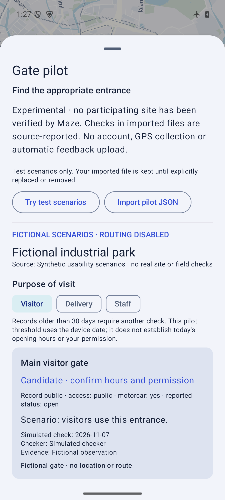

# Gate pilot prototype · implementation findings

7 November 2026. No real site, checked gate dataset or human reviewer response was supplied. All test records are synthetic; the route-integration fixture uses a public landmark coordinate explicitly labelled NOT a gate. This report covers software behaviour only.

## Implemented and tested

The extension is reachable from setup without a country pack, from More and from nearby access. It provides six coordinate-free fictional scenarios, visit-purpose controls, explicit motorcar permission, closed/stale/missing-evidence states, provenance text and local file import. Imported checks are reported claims, never independent Maze certification. Real-format records need permission approval and explicit review before storage. No new account, telemetry, service or public MCP access was introduced.

38 JVM tests pass (seven added for the pilot). These include purpose restrictions, staff authority, stale/future dates, missing evidence, motorcar permission, site-specific saved identities, duplicate IDs, invalid coordinates, size/depth limits and concatenated JSON rejection. Lab lint and the minified QA build pass; the offline APK payload gate retains all 256 glyph blocks and notices.

The exact installed QA APK matched SHA256 `4982abeb0fa6f2efc620e743c0c0d088cbec5683f386d500ac0c234aa43b384d`, version `0.4.1-gate-pilot-qa`, code 7. It is locally Android Debug-signed and non-debuggable, with package `my.maze.malaysia.qa` and launcher label **Maze · Gate Pilot**. It installs separately from the current lab app. No production signing or public release qualification is claimed.

On the explicitly owned API 35 ARM64 emulator in airplane mode, the prototype native checks passed. First-use without a country pack was exercised on a predecessor build; the final APK repeated import, destination handoff, purpose, Night and enlarged-text checks with the map installed:

- Fictional scenarios are available without the regional map; no route action is offered for their absent coordinates.
- Invalid import retains current records; import review cancellation retains them; accepted import survives an app restart.
- Removal cancellation retains records; accepted removal survives restart.
- With the matching existing map pack imported, a real-format synthetic fixture requires a road-preview confirmation. Cancellation stays in the pilot; confirmation transfers the selected destination, clears an existing route and does not start another route or navigation.
- The Delivery gate changes from a candidate to “Delivery access only” when the visitor purpose is selected.
- Night rendering and actual 2400×1080 landscape at 200% text were inspected, including reachable purpose controls and scrolling.

The test-only QA app and owned downloads were removed; original emulator settings were restored and the owned instance stopped. The existing lab APK and its private data were not replaced. No physical GPS or real driving was tested.

## Useful feedback from building it

1. **Purpose and vehicle access are separate.** A public or delivery entrance can be pedestrian-only. The prototype requires an explicit motorcar assertion before offering a road preview; truck clearance remains unsupported.
2. **Gate coordinates are insufficient.** The existing router still snaps to a junction within 350 m. Establishing the correct connected approach, direction, barriers and building relationship is the main unresolved navigation work.
3. **Freshness needs an owner.** A check date cannot establish present opening hours. The 30-day limit is provisional and uses an unauthenticated offline device date. A site operator must own corrections and closures.
4. **A role selector is not a credential.** Selecting Staff does not establish a right of entry. Imported “approved” flags are contributor assertions, not authentication or proof of redistribution rights.
5. **An engineering handoff is not operator UX.** JSON import is adequate for an initial controlled test. A property manager’s maintenance workflow still needs observation and independent feedback.

The prototype makes the idea testable as a Maze extension. Correct-gate arrival rate, delay reduction, maintenance cost and willingness to pay remain unmeasured. Use the [review tasks and field-pilot protocol](GATE-PILOT.md) before building commercial dashboards or making benefit claims.
