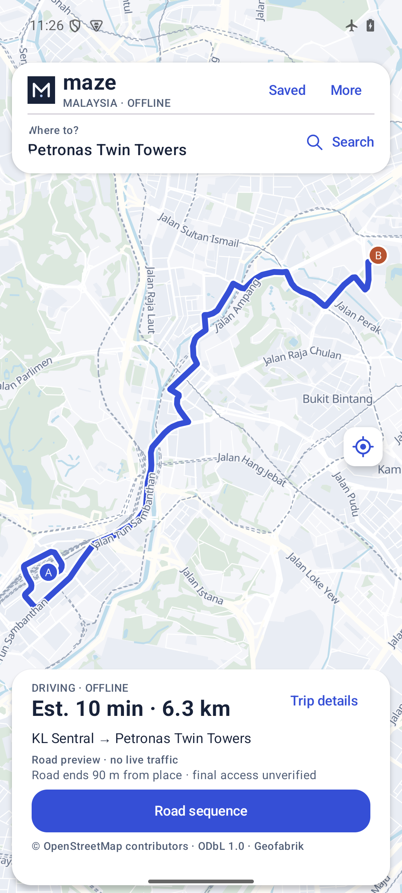
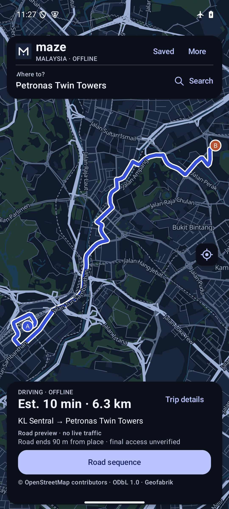

# Directed road approaches · 0.4.2

10 November 2026. Original synthetic OSM fixtures, public Malaysian landmark comparisons and separately identified emulator checks. These are software checks, not field navigation, gate permission or live traffic certification.

## What changed

The previous snapper selected nearby junctions and paired strong components. That missed long road interiors, could reject legal one-way chains and could move endpoints onto farther roads to obtain connectivity. The replacement indexes every geometry segment, projects onto the nearest supported polyline and adds virtual endpoints with direction-aware partial-edge costs. Turn state includes incoming way and previous junction even after a partial start; restrictions are checked before entering a partial destination edge.

Routes clip their first/last geometry to the projections, including two points on the same edge. They never draw a straight-line connector from a place to a road. The journey card shows the remaining straight-line gap and labels access unverified. Projections within 0.5 m along an edge of its endpoint normalize to that topological junction, avoiding false ambiguity from float rounding. Two approaches within 1 m of the nearest distance are rejected unless they project to the same topological junction. This provisional ambiguity tolerance is not calibrated against physical GPS. Disconnected nearest approaches fail; there is no automatic farther-component fallback. The app now asks the user to choose both starting and destination road approaches before calculation. That explicit choice is checked against nearby mapped geometry and retains the original place marker and road gap. It grants no entry permission. A joined SQLite scan retains at most 8,192 compact candidate records / 16 MiB of shape bytes; geometry is decoded lazily with bounded nearest ties. Cancellation/deadline checks apply while scanning and projecting. Outgoing-edge reads also fill the position cache to avoid a SQLite query for every heuristic evaluation. Search budgets, cancellation, Quick weight 4 and Careful weight 1 are unchanged.

A new **r3** country ZIP is required. Its road graph adds 3,220,790 segment-cell entries and an edge-geometry lookup index. Road/turn/access filtering and the source OSM snapshot remain unchanged. The new SQLite graph is SHA256 `f8e6aafbf278b05fc222546b5e1d6797a5b048d472d73b37238a8cff2fa17f0c`; old r2 data is rejected. Saved previews can contain old geometry; refresh them after import. The migrated graph retains historical v9 metadata text; `segment_grid` identifies the added index, while this app's source defines endpoint selection.

## Mature-engine fixture comparison

GraphHopper **10.2**, official JAR SHA256 `ead763749c395ea0cc45b3fd10092d6de84d62fb5cbaf7d416ba6cc142c5716c`, Java17, stock car model, motorcar/motor_vehicle turn costs and 60s U-turn penalty. CH/LM disabled. `prepare.min_network_size: 0` keeps intentionally tiny test networks. Both engines consume the same original synthetic `fixture.osm`; these coordinates are **not real mapped roads** and are never merged into the regional data.

There are twelve scenarios, each tested in Quick and Careful: ordinary one-way forward/reverse, legal divided-road turnaround, divided-road forward, ambiguous median, locked barrier, disconnected closest roads with a farther connected bypass, restricted entry into a partial destination, reverse-tagged one-way forward/reverse, and curved same-edge travel in both directions.

All seven routable scenarios use the same directed way sequences as GraphHopper in JVM checks, with distance differences below 2 m. Four disconnected/illegal-direction scenarios are rejected by both engines. **The median case intentionally differs:** GraphHopper selects one carriageway; Maze asks for a clearer road point. The comparison preserves that difference instead of reporting twelve identical results. [Exact mode comparisons](fixture-comparison.json) · [GraphHopper responses summarized](graphhopper-fixture-results.json).

The first fixture revision returned a GraphHopper bounds error for curved-road queries: its highest latitude was an intermediate shape point. An explicit distant extent road fixed the test setup. Only the corrected fixture is used for accepted comparison results; the earlier failed requests are retained in the local case.

## Reproduce

1. Run `./gradlew :app:testLabUnitTest :app:lintLab :app:assembleQa` with the pinned project SDK/JDK17. `MazeApproachTest` uses builder-exported graph rows and verifies partial geometry, directions, restrictions, ambiguity, cancellation and deadlines. Existing A* tests cover budgets and approach-state separation.
2. Run `python3 -B -m unittest discover -s tests -v` and, with `requirements-data.txt` installed in an isolated environment, `python tools/test-offline-build.py`. Rebuild the original fixture with `python tools/build-approach-fixture.py /new/fixture-directory`; existing outputs are preserved.
3. Use the pinned [official JAR](https://repo.maven.apache.org/maven2/com/graphhopper/graphhopper-web/10.2/graphhopper-web-10.2.jar) and `graphhopper-fixture.yml` beside `fixture.osm`. Start only an owned loopback server: `java -Xmx512m -jar graphhopper-web-10.2.jar server graphhopper-fixture.yml`. Submit the exact points in `app/src/test/resources/approaches/graph.json` to `/route` with `profile=car`, `points_encoded=false`, `details=osm_way_id`. Retain responses and compare actual snaps and directed ways. Stop the owned server afterwards.
4. For an explicit reviewed country graph, `python tools/index-road-segments.py /source/v9.sqlite /new/v10.sqlite /new/receipt.json` copies it before indexing. Package only the three selected public datasets using `tools/package-offline-pack.py`, review/pin the manifest and rebuild. Do not use the historical junction-only host benchmark as the current router: it now requires explicit acknowledgement on segment-indexed data.
5. On an explicitly owned API 35 ARM64 emulator, install the exact QA APK and verify its installed hash. With airplane mode on and no validated external network, run the fixed fixture controller: `adb -s EXPLICIT_EMULATOR shell am instrument -w -e scope fixture my.maze.malaysia.qa/my.maze.malaysia.ApproachProof`. It reconstructs a small original synthetic SQLite fixture from bundled SQL, checks both modes against pinned GraphHopper distances and rejects expected failures. It accepts no arbitrary path, query or upload. QA only; main/release variants exclude this controller and fixture.
6. Import the matching r3 ZIP through Android's picker. Run the controller with `scope country`, then inspect the actual day/night map, road overlay, endpoint gap and enlarged-text layout. A passing controller is not visible-map proof. Never auto-select a device or operate a showroom display.

## Remaining work

A place projected onto a road still does not establish a driveway, barrier crossing, right of entry, correct side of a building, vehicle clearance or opening hours. Grade-separated/parallel-road GPS ambiguity needs heading and reported-accuracy handling, labelled traces and a calibrated rejection policy. Full via-way restriction sequences and long-distance preprocessing remain priorities. Existing barrier/private/conditional/dimensional exclusions stay conservative; no new roads, access rights or traffic are inferred.

WhatIF is used here as an explicit functional/failure matrix backed by JVM, builder, native SQLite and UI evidence. Its source heuristic selected Python tools, found no leads and does not parse Kotlin; that is not a security pass. No dummy HTTP server, external load test, synthetic-user feedback or capacity claim substitutes for native routing tests. Six current GraphHopper city baselines completed; the intercity baseline hit a 60s client timeout and is retained as a failure, not a successful result.

## KLCC data finding

The nearest tower approach is Persiaran Petronas way 836257532, approximately 67 m away. Its incoming chain ends at node 5464328366 with no incoming edge in the conservative graph. Earlier SCC pairing silently selected the connected network instead. A dense-cell cap and a false shared-junction ambiguity were also found on the real KL run; accepted source uses joined candidate reads, cancellation, bounded memory and 0.5 m endpoint normalization. The review controller explicitly chooses mapped Persiaran Petronas way 754168118 (about 90 m from the tower) for the KL arrival test. This is a reviewed road preview, not a route to a verified tower entrance. The first attempted reference name, Jalan Ampang, was absent from the offered set and was rejected rather than substituted.

## Exact APK and emulator outcome

The isolated minified, non-debuggable `my.maze.malaysia.qa` APK, version 0.4.2-road-approaches-qa / code 8, is SHA256 `2e9ec68453cacb4e2c403f6a02aef7e3593cfa4ebd42a68c6aab3b947d34d8e2`. Installed hash matched. Locally Android Debug-signed; not store signing. All **45 JVM tests**, Lab lint, minified QA build, **11 stdlib Python tests** and two OSM builder fixtures passed. The payload retains all 256 glyph blocks and notices; no country databases are bundled.

The owned API 35 ARM64 emulator, airplane mode and no validated external network, passed all 24 synthetic mode checks and **13 declared-road route computations**: seven Quick journeys, six Careful city journeys. Each country report records the actual selected OSM way IDs, road names and place-to-road gaps. These are explicit selections corresponding to public roads from the previous benchmark, not automatic success at landmark coordinates. Strict nearest-geometry attempts failed at isolated arrival/departure points; those failures drove the explicit two-sided chooser and remain retained locally.

| Journey | Quick km | Careful km |
|---|---:|---:|
| KL Sentral–KLCC | 6.305 | 6.305 |
| KLCC–KL Sentral | 7.073 | 7.073 |
| Merdeka–Sentral | 2.599 | 2.599 |
| George Town–Gurney | 5.216 | 5.216 |
| Kuching–Vivacity | 6.116 | 6.116 |
| Kota Kinabalu–Suria | 1.659 | 1.659 |
| Sentral–George Town | 398.365 | not run |

[Native route receipts](android-country.json) · [native fixture receipts](android-fixture.json) · [paired artifact identity](qualification.json). Country GraphHopper requests used the original landmark coordinates, not these selected approaches: their distances are not an apples-to-apples fastest-route comparison. The exact same-input synthetic comparison above is the controlled direction/barrier check.

The exact APK's actual map was inspected in Day and Night, showing the 6.3 km road overlay, original place markers and **Road ends90 m from place · final access unverified**. Both road-review sheets and cancellation before calculation were exercised. Actual 2400×1080 landscape at 200% text kept a scrollable trip panel; its Road sequence action was reached and opened. This is scoped layout evidence, not full accessibility qualification.

The r3 ZIP was imported through the native picker on a predecessor APK with the same pinned manifest/importer and retained across verified QA-only upgrades. The final APK opened that data and computed the checks above. An earlier candidate rejected an old ZIP; its current message can conflate old and damaged packs, which remains a wording improvement. A cold-boot System UI ANR was recorded and recovered with Wait before accepted UI checks. No physical device, field GPS, actual entrance arrival, battery benchmark or comprehensive national routing claim follows.

Next: clearer road-choice location previews and data-disconnection explanations; full via-way turn sequences; heading/accuracy-aware matching; regional downloads and measured long-distance preprocessing. No AI-generated road or traffic data is used.
