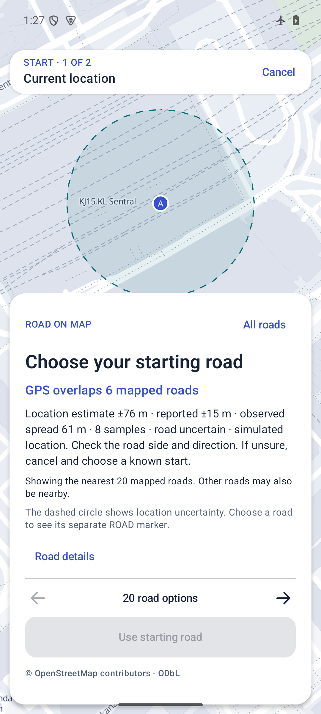
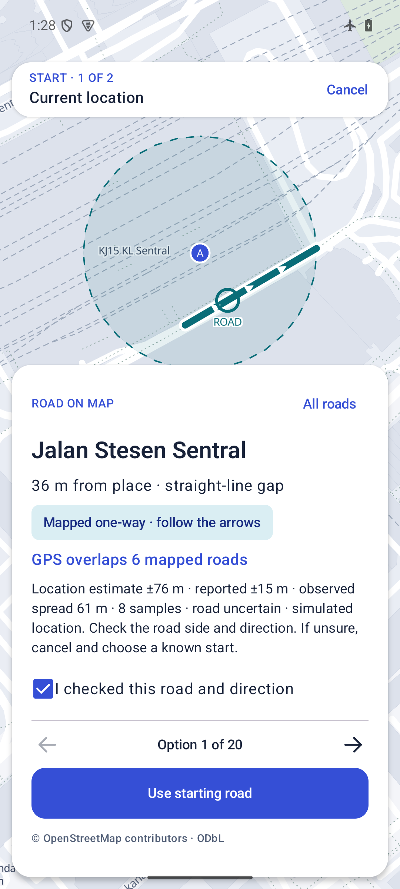
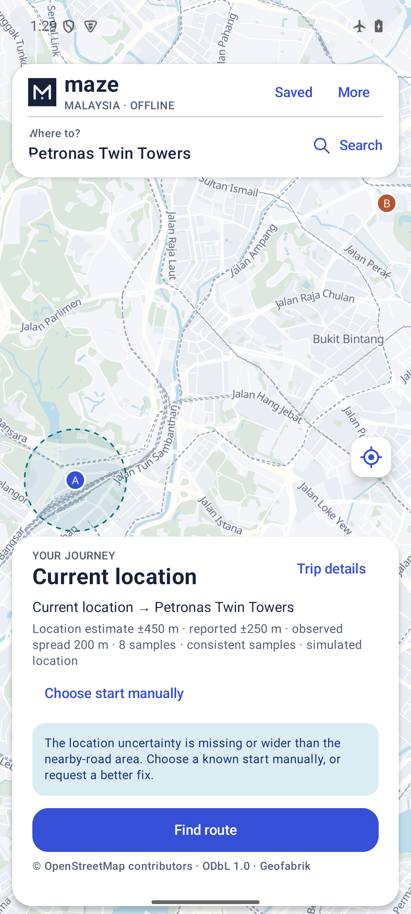
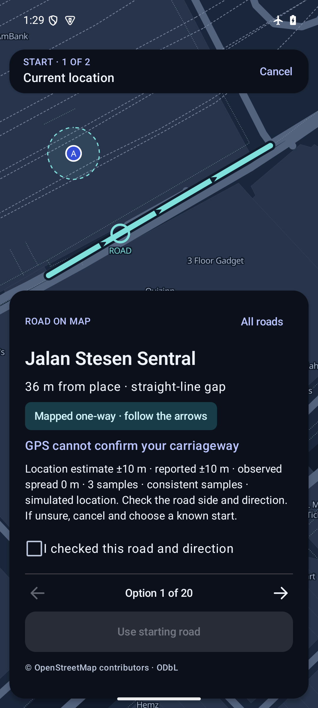
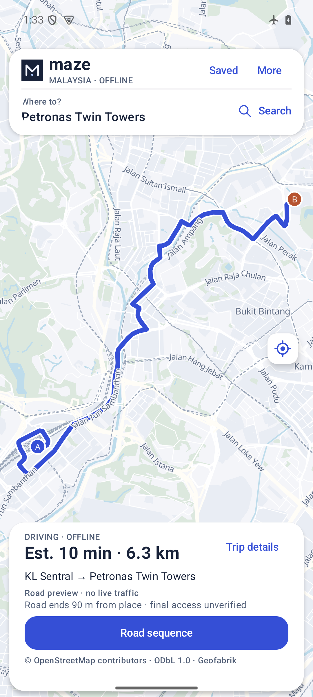
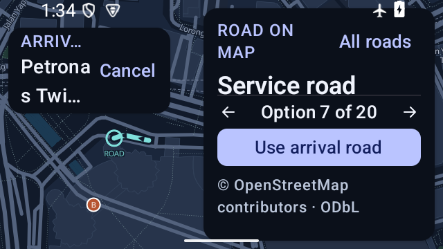

# Noisy GPS and carriageway review · 0.4.4

10 November2026. Bounded location uncertainty and deliberate road selection on the existing offline map. No new provider, background tracking, hosted map matching, positional averaging or inferred crossing.

## Change and failure being addressed

0.4.3 could finish a request on the first fix reporting<=50m, retain the lowest reported radius until timeout, and automatically preview the nearest road for a GPS start. That combination could look decisive when samples drifted between carriageways. Its numeric uncertainty also had no expiry before later route calculations.

0.4.4 keeps up to8 recent samples in a20s request and checks spacing, monotonic freshness and consistency. It uses the latest actual sample. The displayed estimate encloses retained reported radii around that point; reported accuracy, observed spread and sample count stay separate. It never averages points across a median or claims a new confidence probability. One sample cannot end the request early. Input/provider, sample-window and snapshot thresholds are fully specified in [GPS.md](../../GPS.md).

A GPS start has no selected road or highlighted snap until the user chooses one. Mapped ways falling within the estimate are counted before the20-choice display limit. The selected actual segment and one-way direction are then previewed, and a road/direction checkbox is required before commitment. Changing the road resets the checkbox; the ViewModel also rejects unacknowledged confirmation. Broad/missing uncertainty needs a known manual start. Old snapshots cannot start a new route after a provisional two-minute monotonic review budget, and retry invalidates the previous live snapshot. Saved previews do not become live GPS confidence.

This prevents an automatic nearest-road decision in this flow. It cannot prove the true carriageway, remove a consistent GNSS bias or prevent a user from choosing an unsuitable mapped road. It preserves the existing directed graph and access/turn constraints.

## Exact artifact and local checks

Package `my.maze.malaysia.qa`, code10, version `0.4.4-gps-review-qa`, APK63,894,883 bytes. SHA256 `8b49eac779fd51fb55a454ac57d3e38a4cab0f95c71a6f1f6c783bc7dc3472b8`. Minified and non-debuggable, signed with the existing local Android Debug reviewer certificate (`48bbe5abac5ce1f8e1078fcb0757e5053747f05645ae1114d0a9756bad1a22f5`). [Installed APK identity](apk-identity.json).

`./gradlew --max-workers=2 :app:testLabUnitTest :app:lintLab :app:assembleQa` passed on JDK17/pinned SDK/wrapper:61 JVM tests, zero failures/errors, lint and QA assembly. New tests cover spaced samples, first-fix refusal, alternating carriageways, latest versus optimistic old accuracy, stale/pre-request/future data, mixed providers, bounded recovery, extreme disagreement, coarse/weak labels, snapshot expiry and overlap counting beyond20 choices. The built APK passed signature and offline-payload verification:256 glyph blocks, notices present, country databases separate. [Qualification identity](qualification.json).

A synthetic divided-road test deliberately moves the input across roughly22m of synthetic carriageway separation. The nearest way changes, both mapped sides overlap the30m estimate, and an explicitly selected side remains the same directed way. These are authored synthetic roads, never merged into Malaysia data. They demonstrate application behavior, not field positioning accuracy.

## Exact-APK native acceptance

Explicitly owned AV3X_Antartica_QA emulator, API35/ARM64,192MiB heap growth limit. Airplane mode, Wi-Fi and mobile data off, no validated external network. The r3 pack was imported on the published0.4.3 QA APK, then retained through verified QA-only candidate upgrades to the final APK. [Initial upgrade stage](apk-identity-upgrade-stage.json) and [final installed identity](apk-identity.json) preserve that sequence.

- [5 GPS/carriageway checks](android-gps.json): one optimistic fix not ready; alternating fixes keep an actual point and widen the estimate; latest expiry; consistent sample completion; nearest-side flip versus explicit-side retention.
- [8 state checks](android-state.json): broad/missing uncertainty, no default GPS road, acknowledgment enforcement, expired/retried snapshots, lookup cancellation and stale-preview rejection.
- [40 source-geometry previews](android-previews.json): all offered Sentral/KLCC options, matching source line/arrow points, direction flags and snap gap.
- [24 routing fixture checks](android-fixture.json), including one-way/reverse-one-way, divided turnaround, ambiguous median, locked barrier and disconnected nearest approaches. These reuse the retained [GraphHopper10.2 same-source baseline](../2026-11-approaches/README.md); GraphHopper was not newly run for the GPS policy change.
- [13 offline journey/mode checks](android-country.json), including KL Sentral–KLCC6.3km in both modes on the declared road choices. These are weighted offline previews, not real-world fastest-route guarantees.

## Android provider and visible UI

[Android test-provider/UI receipt](android-provider-ui.json) is tied to the same installed APK hash. Six accepted scenarios: no fresh sample timeout; one optimistic sample followed by60m alternating drift; no default road, disabled confirmation until acknowledgment and reset on road change; broad250m reported radius plus200m drift; background cancellation with late data ignored; independent consistent retry and Night review. The combined drift/review case includes explicit handoff to arrival selection.

The noisy run displayed **estimate±76m / reported±15m / observed spread61m /8samples**, labelled simulated and road uncertain. Six supported mapped ways overlapped the estimate. The broad run displayed **estimate±450m / reported±250m / spread200m**, and required a known manual start. The consistent retry displayed **estimate±10m / reported±10m / spread0m /3samples**. These are injected scenarios, not measured receiver accuracy. The test provider was removed and shell mock permission mode restored afterward.

An early controller assertion read the enabled TextView label inside a disabled Compose button. The visible button and its clickable ancestor were disabled. The controller was corrected to inspect ancestor state and reran the full scenario set; its failed receipt remains local. Screenshot review also caught ambiguous ring wording in the no-selection state. That copy was fixed, rebuilt, and all accepted native/provider/UI checks use the corrected APK identity above.

[UI qualification aggregate](ui-qualification.json) records independent pixel inspection separately from controller assertions. The same APK passed rapid selection to option6, two-way preview, numbered list selection, cancellation before routing, explicit start/arrival confirmation, cancel while editing an existing route and Day/Night. The actual6.3km route overlay was visible. At360×640 and actual640×360 with200% text and animation scales0, primary controls stayed inside the viewport; selection changes and cancellation worked. The extreme landscape place header still truncates/wraps, so this is scoped layout evidence, not full accessibility certification. Two transient null-root UI dumps were retried by the bounded controller; they were not treated as app assertions.

## Retained failures and limitations

An initial cold boot reported completion before the phone service was available; setup stopped at the mobile-data command. The owned runtime was restarted after compilation. A subsequent System UI ANR dialog appeared on the published predecessor APK before import; Wait and a fresh predecessor launch recovered it. Failed setup/screenshots are retained locally and excluded from accepted app results. The final build was serialized with runtime work after an earlier overlapping build/emulator run was slow. No performance gain is inferred.

The unchanged r3 ZIP was verified and imported through Android's picker on the exact published0.4.3 APK, then retained through the same-ID/certificate update. Import and native data checks remain separate from compilation. Pack SHA256 `6b16d4e6ffc7d432877e5cc1135ca1465e0a483a8e2ef35ea90e04eb3da9f95c`; road DB pin `f8e6aafbf278b05fc222546b5e1d6797a5b048d472d73b37238a8cff2fa17f0c`. Source OSM date4November2026. No new pack or graph restrictions were introduced.

No physical budget handset, satellite acquisition, urban-canyon error, battery, field arrival or full accessibility qualification. Consistent bias and wrong user choice remain possible. Reported accuracy is a provider estimate; the displayed envelope is an uncalibrated heuristic. Next gate: opt-in labelled field traces, wrong-road rate and lag on representative devices, lifecycle and energy checks before continuous/automatic matching.
