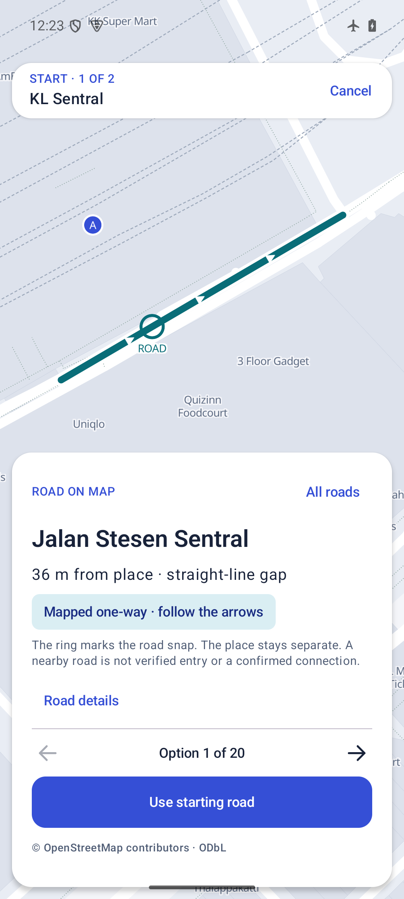
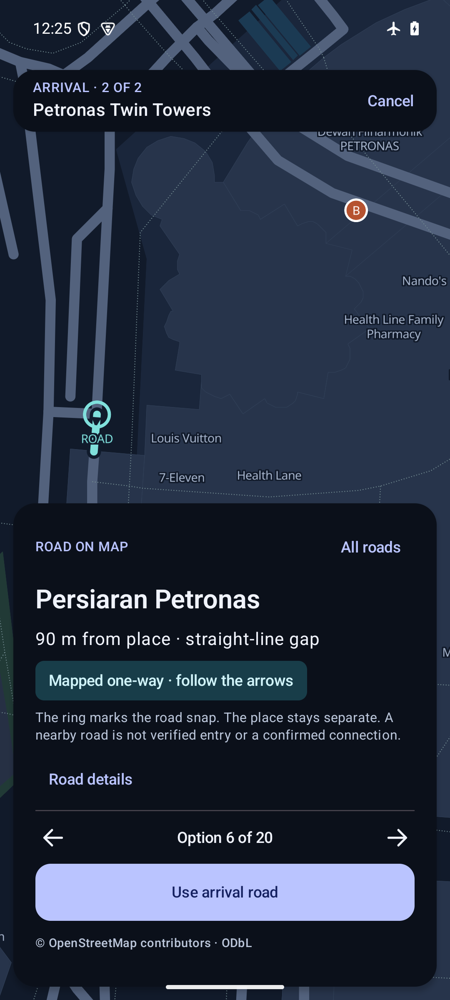
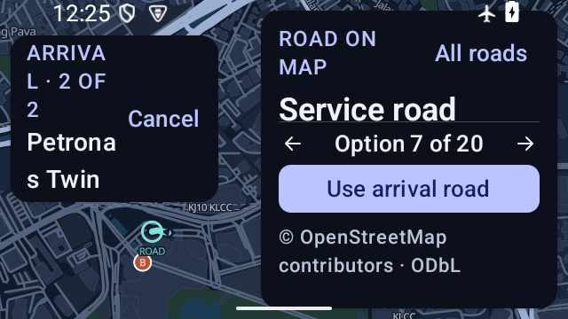
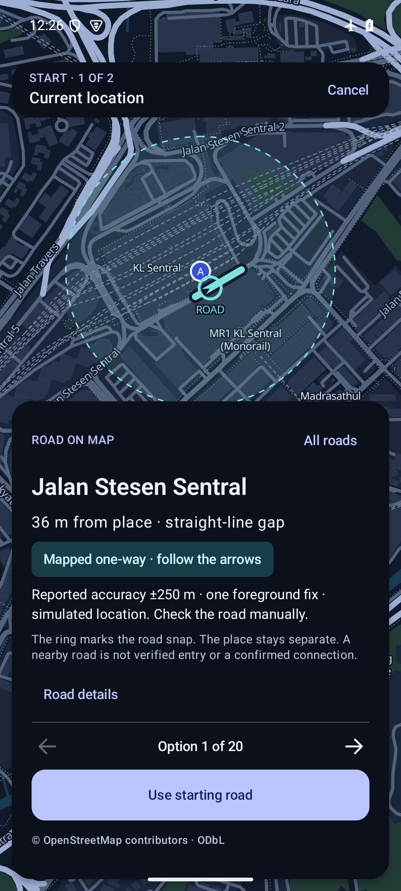

# Visual road approaches · 0.4.3

10 November 2026. Android reviewer preview, using the existing r3 OSM pack. No new map provider, account, hosted routing service or traffic feed.

## Behavior

Every road option has its own actual geometry highlight, projected ROAD ring and readable name. The reviewed place remains a separate A/B marker. A local window of up to 400 m retains bends, and one-way arrows follow the stored direction, including reverse-tagged ways. Two-way roads have no directional arrows. No connector is drawn across the place/road gap. Directions describe the offline graph, not today's conditions or permission to enter.

Previous/next and the numbered All roads list preview without committing. Confirm becomes available only after the current loaded preview has been applied to the map source. This is not a GPU presentation acknowledgment; actual screenshots were inspected separately. Loading clears the old preview. Cancellation invalidates pending results, does not reopen the chooser and preserves an existing route. Geometry display is bounded to 2,048 points; the preview cache retains at most four entries. No animated camera flight.

Provider-reported uncertainty remains numeric, with a dashed estimate ring. A current start reporting more than 350 m uncertainty requires a known manual start because it exceeds the nearby-road search area. Neither the circle nor road highlighting repairs GPS hardware or proves the correct carriageway. Saved trips retain their existing local storage behavior; numeric live uncertainty is not reconstructed from saved prose.

## Exact artifact and checks

Package `my.maze.malaysia.qa`, version `0.4.3-visual-approaches-qa`, code 9. Minified, non-debuggable, locally Android Debug signed (same reviewer certificate as 0.4.2). APK 63,878,495 bytes, SHA256 `18d4a662e173ad94975a5f461b19b9e9ab9f7017d18806df2549c187dd0d432b`. [Installed identity](apk-identity.json). This is a test APK, not a Play Store production release.

JDK17/pinned wrapper: `./gradlew :app:testLabUnitTest :app:lintLab :app:assembleQa` passed: 50 JVM tests, lint and QA assembly. The five new tests cover line clipping, bend/source fidelity, normalized endpoint agreement, direction bearings, invalid choices, uncertainty rings and manual-start thresholds. The APK payload verifier found all 256 local glyph blocks, license notices and separate country databases. APK signature verification passed.

The same installed APK ran on the explicitly selected owned `AV3X_Antartica_QA` emulator, Android 15/API35 ARM64, 192 MiB heap growth limit. Native tests, in airplane mode with Wi-Fi/mobile data disabled:

- [40 road previews](android-previews.json): all 20 starting and 20 arrival options for Sentral/KLCC; every displayed line/arrow lies on its source geometry.
- [24 direction/barrier fixture checks](android-fixture.json), Quick and Careful. These reuse the [GraphHopper 10.2 same-source comparison](../2026-11-approaches/README.md); GraphHopper was not newly rerun for this display-only change.
- [13 offline journey/mode checks](android-country.json). The selected Sentral–KLCC journey remains 6.3 km in both Quick and Careful. These are weighted route previews, not fastest-route guarantees.
- [3 state checks](android-state.json): 5 km uncertainty blocks road selection, cancel during road lookup stays closed, and delayed preview work cannot reopen the chooser.

## Runtime review

Accepted interaction and layout receipts are in [UI qualification](ui-qualification.json). Actual map screenshots, rather than design mockups, accompany this report. Review covers option switching, two-way geometry, explicit start/arrival confirmation, cancel before calculation, cancel while editing an existing route, Day/Night, constrained portrait/landscape and enlarged text. Scope is layout and flow, not full accessibility certification.

The first 200% text / small landscape review caught crowding between the header and chooser. The corrected layout shares available width and measures the full header inset before fitting the camera. An initial harness dependency failure and an earlier instrumentation/UI overlap were retained locally, corrected and excluded from accepted results.

The unchanged r3 ZIP was imported through the native picker on a predecessor candidate with the same manifest/importer and retained through QA-only upgrades. Final installed APK/data hashes were checked. Map pack SHA256 `6b16d4e6ffc7d432877e5cc1135ca1465e0a483a8e2ef35ea90e04eb3da9f95c`; road DB SHA256 `f8e6aafbf278b05fc222546b5e1d6797a5b048d472d73b37238a8cff2fa17f0c`.

No physical low-end handset, satellite acquisition, urban-canyon error, battery measurement, field entrance arrival or national navigation certification follows from this emulator run. The next engineering gate is opt-in, labelled field traces on real devices; smoothing a marker is not evidence of better positioning.

The Android test GPS provider supplied ±250 m fixes during a requested foreground session. The final UI showed the simulated label, numeric estimate and full dashed uncertainty ring while retaining the selected road and original place marker. The mock provider was removed afterward. This proves handling of injected accuracy, not real satellite reception. At 200% text on a 640×360 viewport the place header wraps/truncates; map and primary controls remain reachable.

